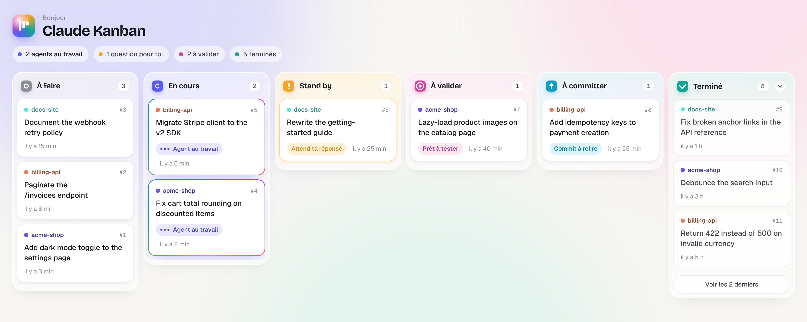

# Claude Kanban (Node.js)

**A local Kanban board that hands tickets to Claude Code agents, with a human reviewing every change.**

You write a ticket. A headless [Claude Code](https://docs.claude.com/en/docs/claude-code) agent picks it up and works on it in your project. You test the result and approve it before anything gets committed or pushed. It works across several projects at once, and everything runs on your own machine.

This is the Node.js port of [claude-kanban](https://github.com/thibaultfradet/claude-kanban). It needs nothing but Node.js: no Python, no native build step, no compiler. It runs on Windows, macOS and Linux, and its `data/kanban.db` is interchangeable with the Python version's.



## How it works

```
To do → In progress → Stand by (question) → To review → To commit → Done
```

1. **To do**: tickets wait here. The scheduler picks the oldest one for each project.
2. **In progress**: Claude Code runs headless in the project folder and follows the ticket plan. It commits small, focused steps on the current branch and never pushes. The live log streams into the ticket page.
3. **Stand by**: if the agent needs a decision, it stops and asks a question. You answer from the ticket page, and the same session resumes with your answer.
4. **To review**: the agent says it's done. You test the change yourself:
   - if something is wrong, send feedback with `/kanban-ticket` from Claude Code. It's appended to the ticket history and the ticket goes back to *To do* with the full context;
   - if it's good, move it to *To commit*.
5. **To commit**: a headless commit pass groups any leftover changes into clean commits. You press **Push** when you're ready.
6. **Done**: pushed.

Each project handles one ticket at a time, so agents never step on each other's changes. Different projects run in parallel.

## Requirements

- [Node.js](https://nodejs.org/) **22.5 or later** (22 LTS or 24 LTS recommended)
- [Claude Code](https://docs.claude.com/en/docs/claude-code) installed and logged in (`claude auth login`)
- Git, with the projects you want to work on already cloned locally

The only npm dependencies are Fastify, `@fastify/static` and Nunjucks, all pure JavaScript. The database uses Node's built-in `node:sqlite` module.

## Getting started on Windows

1. Install Node.js 22 or 24 from [nodejs.org](https://nodejs.org/) (the LTS installer is fine) and Git for Windows.
2. Install Claude Code and log in once from a terminal:

   ```powershell
   claude auth login
   claude -p "say ok"
   ```

   If the second command answers, the board will be able to run agents.
3. Clone the board and start it:

   ```powershell
   git clone https://github.com/thibaultfradet/claude-kanban-node.git
   cd claude-kanban-node
   .\run.cmd
   ```

   `run.cmd` installs the npm dependencies on the first run, then starts the board on **http://127.0.0.1:8787**. You can also double-click it from Explorer, or run `npm install` then `npm start` yourself.

Notes for Windows:

- **Finding `claude`**: the board looks for `claude.exe` first, then the npm `claude.cmd` shim, on the `PATH` and in `%USERPROFILE%\.local\bin` and `%APPDATA%\npm`. A `.cmd` shim is unwrapped to the program it calls, so no `cmd.exe` gets in the way of multi-line prompts. If `claude` lives somewhere else, set `KANBAN_CLAUDE_BIN` to the full path of `claude.exe` (or of Claude Code's `cli.js`).
- **Long tickets**: the prompt is sent to Claude through stdin, not on the command line, so Windows' 32K-character command-line limit does not cap the ticket history.
- **Setting variables**: in PowerShell, `$env:KANBAN_MODEL = "opus"; .\run.cmd`. In `cmd.exe`, `set KANBAN_MODEL=opus` then `run.cmd`.

## Getting started on macOS / Linux

```bash
git clone https://github.com/thibaultfradet/claude-kanban-node.git
cd claude-kanban-node
./run.sh
```

## Install the Claude Code commands

The repo ships two slash commands in [`claude-commands/`](claude-commands):

| Command | What it does |
|---|---|
| [`/kanban-ticket`](claude-commands/kanban-ticket.md) | Run from a Claude Code session in any project. Claude analyzes the code, asks clarifying questions, writes a detailed plan and creates the ticket on the board. It also sends feedback on an existing ticket. |
| [`/commit`](claude-commands/commit.md) | Groups changes into coherent commits with `<type>: <message>` messages. Used by the board's commit step, and handy on its own. |

Copy them into your user-level commands so they're available in every project.

Windows (PowerShell):

```powershell
New-Item -ItemType Directory -Force "$HOME\.claude\commands" | Out-Null
Copy-Item claude-commands\*.md "$HOME\.claude\commands\"
```

macOS / Linux:

```bash
mkdir -p ~/.claude/commands
cp claude-commands/*.md ~/.claude/commands/
```

## Creating a ticket

Open Claude Code (CLI or desktop) in the project you want to work on and run:

```
/kanban-ticket add a dark mode toggle to the settings page
```

Claude asks questions until the plan is unambiguous, because the agent that runs the ticket later can't ask you anything mid-run except through *Stand by*. The ticket then appears in *To do*, and the project is added to the board automatically.

You can also create tickets directly through the API:

```bash
curl -X POST http://127.0.0.1:8787/api/tickets \
  -H "Content-Type: application/json" \
  -d '{"project_name": "my-app", "project_path": "/path/to/my-app", "title": "Add dark mode", "plan": "..."}'
```

From PowerShell:

```powershell
Invoke-RestMethod -Method Post http://127.0.0.1:8787/api/tickets -ContentType "application/json" `
  -Body (@{ project_name = "my-app"; project_path = "C:\dev\my-app"; title = "Add dark mode"; plan = "..." } | ConvertTo-Json)
```

## Model & effort per ticket

Each ticket can pick its own Claude model (`opus`, `sonnet`, `haiku`, `fable`) and effort (`low`, `medium`, `high`, `xhigh`, `max`). Left unset, it uses `KANBAN_MODEL` / `KANBAN_EFFORT` (`opus` / `high`); the default is never stored, so changing it applies to existing tickets too. The commit pass always uses `KANBAN_COMMIT_MODEL` / `KANBAN_COMMIT_EFFORT`.

Set them in the ticket page ("Modèle" / "Effort" selects), when creating a ticket (`model` and `effort` are optional fields of `POST /api/tickets`), or with `/kanban-ticket`, which proposes a pair based on the plan's complexity. Cards show the effective pair as a small badge, dimmed when it is the default.

```bash
curl -X PATCH http://127.0.0.1:8787/api/tickets/42/settings \
  -H "Content-Type: application/json" \
  -d '{"model": "sonnet", "effort": "medium"}'
```

An omitted field stays unchanged, `null` resets it to the default. The response is `{"ticket_id", "model", "effort", "effective_model", "effective_effort"}`. Invalid values return 422; the call returns 409 while the ticket is *In progress* (and for *To commit* / *Done*), and otherwise applies to the next run or resume.

## Auto-ship

`scripts/auto_ship.js` is an optional loop that runs next to the board: it moves every ticket in *To review* to *To commit*, waits for the commit pass, then pushes. Failures are logged and left for you to handle.

```bash
npm run auto-ship              # all projects
node scripts/auto_ship.js my-app   # only the named projects
```

## Configuration

Set these environment variables before starting the board:

| Variable | Default | Purpose |
|---|---|---|
| `KANBAN_PORT` | `8787` | Port the board listens on (always on `127.0.0.1`) |
| `KANBAN_MODEL` | `opus` | Default model for ticket runs (start and resume) |
| `KANBAN_EFFORT` | `high` | Default effort for ticket runs |
| `KANBAN_COMMIT_MODEL` | `sonnet` | Model of the automatic commit pass ("To commit") |
| `KANBAN_COMMIT_EFFORT` | `low` | Effort of the automatic commit pass |
| `KANBAN_TICKET_TIMEOUT` | `1800` | Max duration of a single run, in seconds |
| `KANBAN_POLL_INTERVAL` | `20` | How often the scheduler looks for new tickets, in seconds |
| `KANBAN_CLAUDE_BIN` | `claude` from the `PATH` | Path to the Claude Code binary |
| `KANBAN_NOTIFY` | `1` | Set to `0` / `false` / `no` to disable all desktop notifications |
| `KANBAN_NOTIFY_EVENTS` | `standby,a_valider,error` | Comma-separated list of events to notify |

Only one board should run per `data/` folder. A second instance on the same port exits right away instead of touching the running tickets.

## Notifications

The board sends native desktop notifications (info only, no click action) when a ticket needs you:

- `standby`: the agent asked a question;
- `a_valider`: the agent finished and the ticket is ready to review;
- `error`: a run failed or timed out, Claude could not be launched, the auto-commit failed, or a push failed.

Each one shows the project name, ticket id and title. The command used depends on the OS:

| OS | Command |
|---|---|
| Windows | `powershell` toast (`ToastText02`) |
| macOS | `osascript -e 'display notification ...'` |
| Linux | `notify-send` (skipped if not installed) |

On Windows the toast is attributed to Windows PowerShell: if nothing shows up, check that its notifications are allowed in Settings → System → Notifications, and that Focus assist is off. On macOS the first notification may be attributed to "Script Editor": allow it in System Settings → Notifications.

## ⚠️ Safety

Agents run with `--permission-mode bypassPermissions`: they can read, write and run commands in the project folder without asking. That is what makes unattended runs possible, so:

- only point the board at projects you trust, ideally with a clean git state;
- review every change in *To review* before moving it on;
- pushing is always a manual step.

## Tech stack

Node.js (ESM, no build step), Fastify, Nunjucks templates, the built-in `node:sqlite` module, and server-sent events for the live board and logs.

> The board's interface is currently in French.
